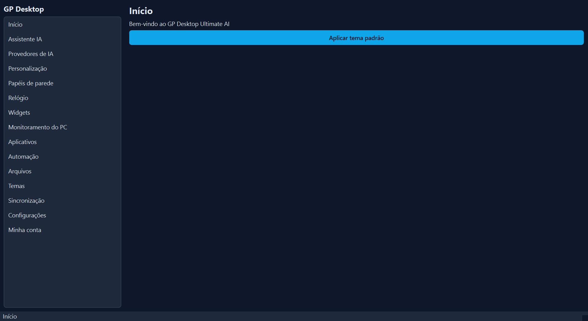
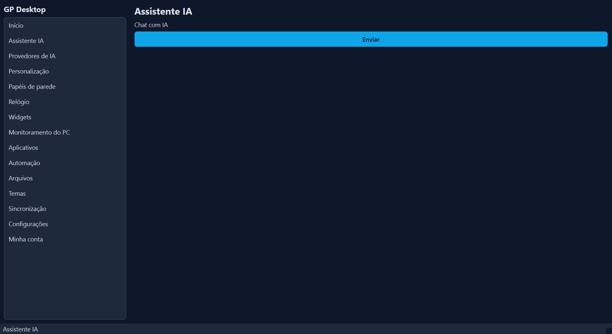
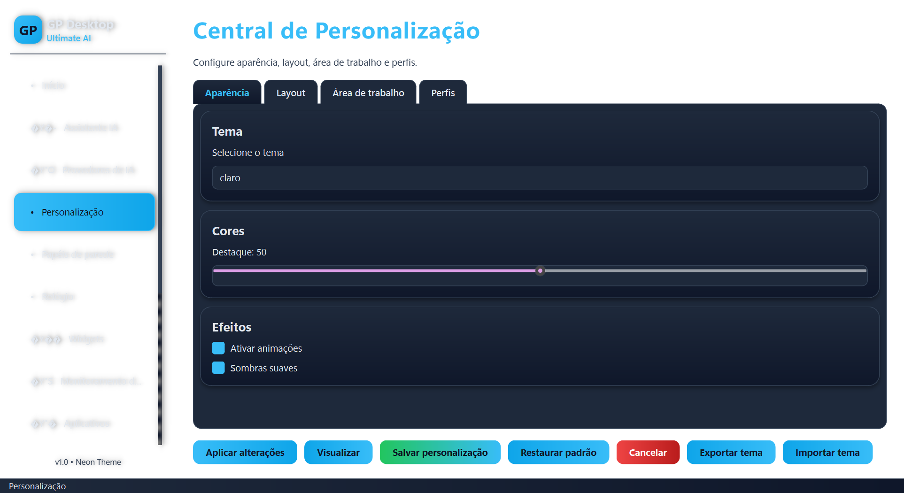
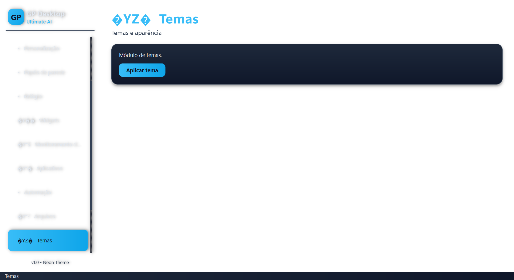
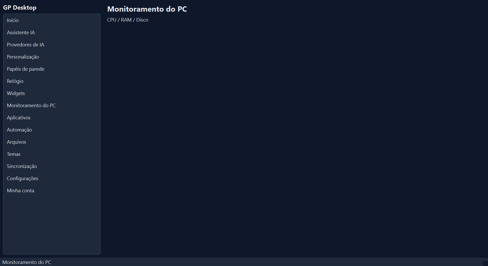
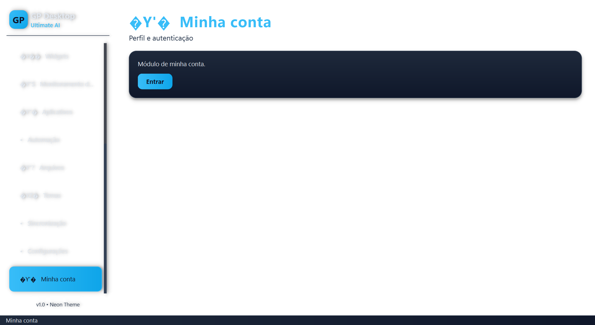

# GP Desktop Ultimate AI

Aplicativo desktop profissional para Windows, construído com PySide6 (Qt) e
integrado ao Supabase (autenticação, banco de dados, realtime, storage).

## Screenshots













## Instalação rápida (comandos)

```powershell
# 1. Clonar
git clone https://github.com/gptecnologiasite-bot/gp-desktop-ultimate-ai.git
cd gp-desktop-ultimate-ai

# 2. Ambiente virtual
python -m venv .venv
.venv\Scripts\activate

# 3. Dependências
pip install -r requirements.txt

# 4. Configurar Supabase
copy .env.example .env
# edite .env com SUPABASE_URL e SUPABASE_ANON_KEY

# 5. Rodar
python main.py
```

## Requisitos

- Python 3.11+
- Windows 10/11 (alguns recursos usam APIs do Windows)
- Conta/projeto Supabase

## Instalação (desenvolvimento)

1. Clone/baixe o repositório para uma pasta fora do OneDrive, por exemplo
   `C:\dev\pessoal\gp-desktop-ultimate-ai`.
2. Crie um ambiente virtual e instale as dependências:

   ```bash
   python -m venv .venv
   .venv\Scripts\activate
   pip install -r requirements.txt
   ```

   ou, via `pyproject.toml`:

   ```bash
   pip install -e .
   ```

3. Configure as variáveis de ambiente copiando `.env.example` para `.env` e
   preenchendo `SUPABASE_URL` e `SUPABASE_ANON_KEY`:

   ```bash
   copy .env.example .env
   ```

4. (Opcional) Aplique o schema inicial no Supabase executando o SQL em
   `migrations/0001_init.sql` (ou `supabase/migrations/0001_init.sql`) no SQL
   Editor do projeto.

5. Execute o aplicativo:

   ```bash
   python main.py
   ```

## Configuração do Supabase

As credenciais são lidas de variáveis de ambiente (ou do arquivo `.env` na raiz
do projeto):

- `SUPABASE_URL` — URL do projeto (ex.: `https://xxxx.supabase.co`).
- `SUPABASE_ANON_KEY` — chave anônima (anon/public) do projeto.

O cliente Supabase é um singleton (`supabase/client.py`) e pode ser resetado
para testes via `reset_client()`.

## Testes

```bash
pytest
```

Os testes definem `SUPABASE_URL`/`SUPABASE_ANON_KEY` padrão via
`os.environ.setdefault`, então não é necessário um `.env` para rodar a suíte.

## Build do executável

O build usa PyInstaller. O script `installer/build.py` gera o `.spec`
programaticamente:

```bash
python installer/build.py                # onefile (padrão)
python installer/build.py --mode onedir  # onedir
python installer/build.py --clean        # limpa build/dist antes
```

Saída em `dist/`. O executável se chama `GPDesktopUltimateAI`.

### Instalador (Inno Setup)

Gere o script `.iss` (apenas texto) com:

```bash
python installer/build_installer.py
python installer/build_installer.py --version 1.0.0
```

Compile com o Inno Setup (`ISCC.exe installer/GPDesktopUltimateAI.iss`).

## Módulos

Veja `docs/ARCHITECTURE.md` para a estrutura completa. Resumo:

- `assistant/` — chat, comandos e voz.
- `automation/` — automação de arquivos, programas e tarefas.
- `clock/` — relógio flutuante e modelos.
- `interface/` — janela principal (Qt).
- `monitor/` — monitoramento do sistema.
- `personalization/` — perfis e personalização.
- `providers/` — provedores de IA (OpenAI-compat, Anthropic, Gemini, etc.).
- `security/` — DPAPI e gerenciador de credenciais.
- `settings/` — gerenciador de configurações.
- `supabase/` — cliente, auth, database, storage, realtime, edge functions.
- `synchronization/` — sincronização.
- `themes/` — temas e estilos.
- `wallpaper/` — biblioteca, player e wallpaper do Windows.
- `widgets/` — widgets do sistema.
- `windows/` — notificações, atalhos, inicialização, registro, display.

## Modo portátil e ambientes restritos

Para ambientes onde `.bat`/`.cmd` ou instalações são bloqueados, use as
variáveis de ambiente:

- `GP_DESKTOP_PORTABLE=1` — ativa modo portátil (desabilita `.bat`/`.cmd`).
- `GP_DESKTOP_ALLOW_BAT=0` — desabilita abertura de `.bat`/`.cmd`.
- `GP_DESKTOP_SECRET_KEY` — obrigatória para fallback de criptografia quando
  o DPAPI não estiver disponível.

O aplicativo detecta automaticamente se a execução de `.bat`/`.cmd` está
bloqueada e ajusta as opções disponíveis.

## Segurança

Tokens e segredos devem ficar em variáveis de ambiente de nível Usuário
(`GITHUB_TOKEN`, `SUPABASE_ACCESS_TOKEN`, `VERCEL_TOKEN`) e nunca em arquivos
de configuração versionados. O `.env` está no `.gitignore`.
